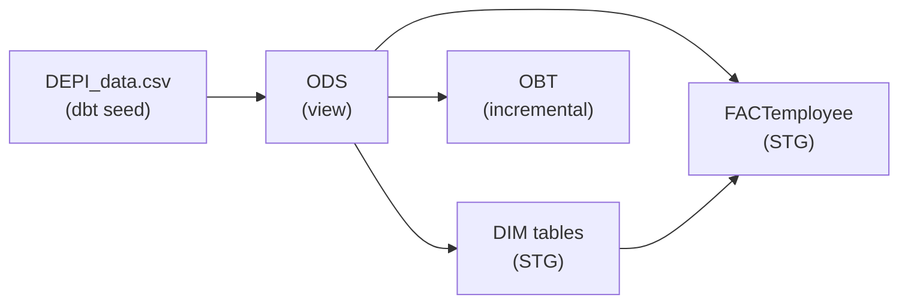
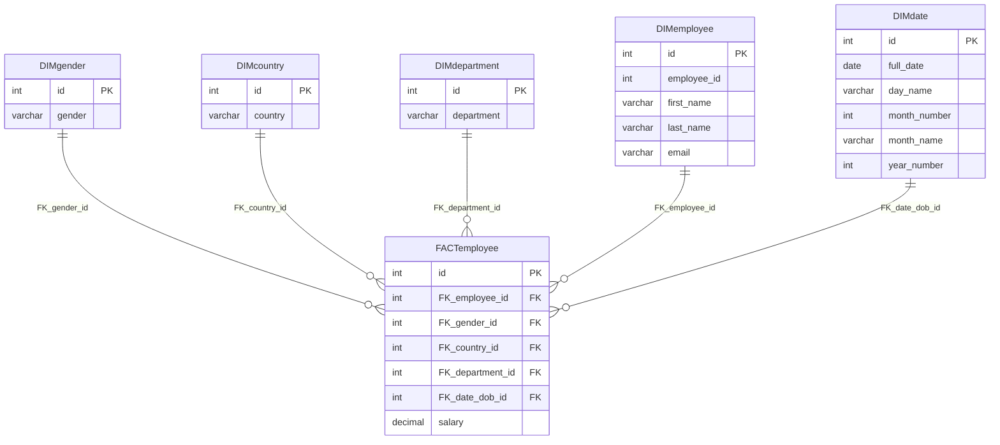

# Employees_DBT

A data engineering project that turns a flat employees CSV into a **star schema** (dimension tables + a fact table) using **dbt** on **SQL Server**.

The data flows through three layers: a raw **seed**, a cleaned **ODS** layer, and a **staging (STG)** layer that holds the dimensions and the fact table, ready to be loaded into a warehouse.

## Architecture



| Layer | Schema | Materialization | Contents |
|-------|--------|-----------------|----------|
| Seed  | default | table | `DEPI_data.csv`, 3,000 employee rows |
| ODS   | `ODS` | view | Direct read of the seed |
| STG   | `STG` | table | Dimensions, fact table, and the OBT |

Schema names are set by the custom `generate_schema_name` macro, so models land in exactly `ODS` and `STG` (no `dbo_` prefix).

## Data model



### Models

| Model | Grain | Notes |
|-------|-------|-------|
| `ODS` | one row per source row | `SELECT *` from the `DEPI_data` seed |
| `DIMgender`, `DIMcountry`, `DIMdepartment` | one row per distinct value | surrogate `id` from `ROW_NUMBER()` ordered by the value |
| `DIMemployee` | one row per employee | `id` is the surrogate key, `employee_id` is the original CSV `ID` |
| `DIMdate` | one row per distinct date of birth | `id` is a `YYYYMMDD` integer key |
| `FACTemployee` | one row per employee | keys to all dimensions plus `salary` as `DECIMAL(10,2)` |
| `OBT` | one row per employee | cleaned "one big table" (incremental), with a `full_name` built by the `capitalize_name` macro |

## Tech stack

- **dbt-core** with the **dbt-sqlserver** adapter
- **SQL Server** (via `pyodbc` and the Microsoft ODBC driver)
- **Python 3.13+**, managed with **uv**

## Project structure

```
.
|-- pyproject.toml          # Python dependencies (dbt-core, dbt-sqlserver, pyodbc)
|-- uv.lock
|-- Depi_DBT_2/             # the dbt project
|   |-- dbt_project.yml
|   |-- seeds/
|   |   `-- DEPI_data.csv   # source data
|   |-- models/
|   |   |-- ODS/ODS.SQL
|   |   `-- STG/            # DIM*, FACTemployee, OBT, schema.yml (tests)
|   |-- macros/
|   |   |-- capitalize_name.SQL
|   |   `-- generate_schema_name.SQL
|   `-- tests/
|       `-- NegativeSalary.SQL
`-- README.md
```

## Getting started

### Prerequisites

- A running SQL Server instance and an empty database for the project
- Microsoft ODBC Driver 17 for SQL Server installed (18 also works if you update the `driver` setting)
- [uv](https://docs.astral.sh/uv/) and Python 3.13+

### 1. Install dependencies

```powershell
git clone https://github.com/Omar-Khaled-Salah/Employees_DBT.git
cd Employees_DBT
uv sync
```

### 2. Configure the connection

dbt reads connection settings from `profiles.yml`, which lives **outside** the repository (on Windows: `C:\Users\<you>\.dbt\profiles.yml`) so credentials are never committed. The profile name must match `profile: 'Depi_DBT_2'` in `dbt_project.yml`:

```yaml
Depi_DBT_2:
  target: dev
  outputs:
    dev:
      type: sqlserver
      driver: "ODBC Driver 17 for SQL Server"
      server: localhost
      port: 1433
      database: DEPI_DBT
      schema: dbo
      windows_login: true
      encrypt: false
      trust_cert: true
      threads: 4
```

This example uses Windows authentication against a local SQL Server and a database named `DEPI_DBT`. For SQL authentication, replace `windows_login: true` with `user` and `password`. The `schema: dbo` is only the default; the project overrides it so the models land in `ODS` and `STG`.

### 3. Build everything

```powershell
cd Depi_DBT_2
uv run dbt build
```

`dbt build` loads the seed, creates the ODS view, builds the STG tables, and runs all tests in dependency order. You can also run the steps separately:

```powershell
uv run dbt seed    # load DEPI_data.csv
uv run dbt run     # build models
uv run dbt test    # run tests
```

## Data quality tests

Tests are defined in `Depi_DBT_2/models/STG/schema.yml` and `Depi_DBT_2/tests/`:

- `unique` and `not_null` on the primary keys of every dimension and on `OBT.employee_id`
- `not_null` and `relationships` on every foreign key of `FACTemployee`, so a missing dimension match is caught instead of silently producing a `NULL` key
- `accepted_values` on `DIMgender.gender` (`Male`, `Female`)
- `relationships` checks that every gender, department, and country in `OBT` exists in its dimension
- A singular test, `NegativeSalary`, which fails if any salary in `OBT` is below zero

## Design notes

- **Deterministic surrogate keys.** `ROW_NUMBER() OVER (ORDER BY <value>)` on already-distinct values gives the same key to the same value on every run, so fact rows never silently point to the wrong dimension row.
- **`LEFT JOIN` in the fact table.** If a value has no match in a dimension, the employee row is kept with a `NULL` foreign key instead of disappearing.
- **Salary as `DECIMAL(10,2)`.** Salaries contain cents, so they are not rounded to integers.
- **Date dimension key.** `YYYYMMDD` (for example `19970221`) is compact, human-readable, and sorts in date order.
- **Date dimension scope.** `DIMdate` is built from the distinct dates of birth present in the data, not from a full calendar range.

## Author

**Omar Khaled Salah**

- GitHub: [@Omar-Khaled-Salah](https://github.com/Omar-Khaled-Salah)
- LinkedIn: [omar-khaled-salah](https://www.linkedin.com/in/omar-khaled-salah/)